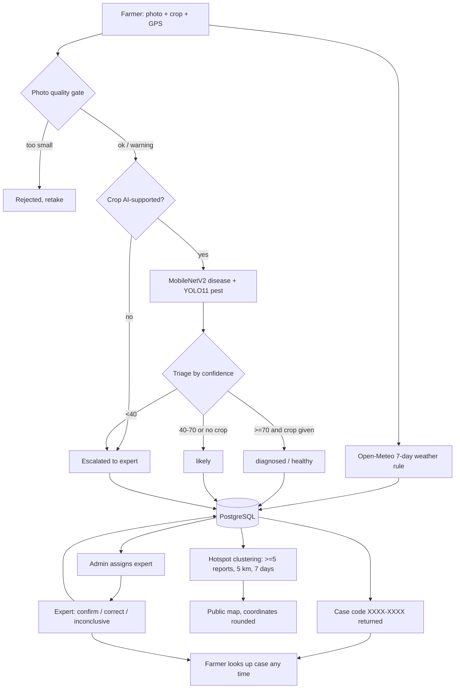

# FasalRakshak AI

Crop disease and pest detection for Indian farmers (SIH 2026, problem SIH26131; legacy name *CropForesight AI*).
A farmer uploads a leaf photo; AI gives a first diagnosis, weather risk and care advice; uncertain or unsupported cases go to human experts; reports are clustered into a public disease map. Farmers need **no login**: each report gets a case code.

**Stack:** React 19 + Vite + react-leaflet · FastAPI + SQLAlchemy 2 · PostgreSQL (SQLite in tests) · MobileNetV2 + YOLO11 · Open-Meteo.

---

## 1. Overall workflow



Step by step:

1. Farmer opens the site, picks a crop, allows browser location (or types lat/lon), uploads a photo.
2. `POST /api/detect` checks photo quality (hard reject under 128 px; warns under 224 px or blurry).
3. If the crop is one of the 9 AI-supported crops, MobileNetV2 predicts the disease with other crops' classes masked out; YOLO11 looks for pests. Other crops go straight to experts.
4. `care.triage()` assigns a tier: **healthy / diagnosed / likely / escalated** and renders advice from the treatment knowledge base.
5. Weather risk is computed from the last 7 days of hourly data. A weather failure never blocks detection.
6. The detection is stored with an 8-character **case code**; the farmer keeps it.
7. Admin sees all reviews, assigns an expert. The expert confirms, corrects or marks inconclusive. Final states are locked; history is logged; the AI prediction is preserved.
8. The farmer can switch the site between English, Hindi and Punjabi. Fixed messages come from `services/i18n.py`; disease advice comes from the `advisories` table (verified rows only) and falls back to English with a note.
9. Farmer enters the case code in "Check my case" and sees the AI or expert result and treatment.
10. Hotspots are recomputed from reports (expert verdicts replace AI labels) and shown on the map.

---

## 2. Project tree

```
HS202_SIH2026/
├── README.md                      this file
├── run-demo.sh                    one command: backend + website (+ public link)
├── docker-compose.yml             Postgres 16 (user/pass/db = hs202)
├── notebooks/
│   └── phase1_weather_rules.ipynb weather rule experiments
├── backend/
│   ├── .env.example               config template
│   ├── Dockerfile                 container image (CPU torch)
│   ├── requirements.txt
│   ├── app/
│   │   ├── main.py                FastAPI app, startup, routers
│   │   ├── config.py              settings from env
│   │   ├── db.py                  engine + session
│   │   ├── deps.py                auth dependencies
│   │   ├── migrations.py          idempotent schema upgrades
│   │   ├── models.py              ORM tables
│   │   ├── schemas.py             Pydantic request/response models
│   │   ├── data/catalogue.json    generated crop/disease catalogue (35 crops)
│   │   ├── routers/
│   │   │   ├── detect.py          POST /api/detect, GET /api/detections/{id}
│   │   │   ├── weather.py         GET /api/weather-risk
│   │   │   ├── reports.py         GET /api/reports, /api/hotspots
│   │   │   ├── auth.py            login, me, change-password
│   │   │   ├── admin.py           experts + review assignment
│   │   │   ├── expert.py          expert queue, decisions, private image
│   │   │   ├── cases.py           GET /api/cases/{code}?lang=
│   │   │   ├── advisories.py      languages, public advice, staff edit/verify/CSV
│   │   │   └── catalogue.py       GET /api/catalogue
│   │   └── services/
│   │       ├── inference.py       model loading + prediction
│   │       ├── labels.py          canonical 38 PlantVillage labels
│   │       ├── care.py            triage + advice rendering
│   │       ├── quality.py         photo quality checks
│   │       ├── catalogue.py       catalogue loader
│   │       ├── advisories.py      multilingual advice lookup + draft/verify workflow
│   │       ├── i18n.py            fixed en/hi/pa messages
│   │       ├── treatments.py      treatment knowledge base (26 diseases)
│   │       ├── weather.py         Open-Meteo client
│   │       ├── risk_rules.py      late-blight risk rule
│   │       ├── hotspots.py        clustering
│   │       ├── reviews.py         review state machine
│   │       ├── cases.py           case-code generation/lookup
│   │       └── security.py        argon2, JWT, rate limiters
│   ├── scripts/
│   │   ├── build_catalogue.py     regenerate catalogue.json
│   │   ├── create_admin.py        create the first admin
│   │   ├── seed_demo.py           demo data (--clear removes it)
│   │   ├── advisories_tool.py     seed-english / export / import / verify advisories
│   │   └── eval_vqa_sample.py     evaluate on PlantExpertVQA sample
│   └── tests/                     72 pytest tests
│       ├── conftest.py  test_detect.py  test_risk_rules.py  test_weather_api.py
│       ├── test_hotspots.py  test_map_api.py  test_auth_review.py
│       └── test_cases.py  test_labels_catalogue.py  test_eval_script.py  test_advisories.py
├── frontend/
│   ├── package.json  vite.config.js  index.html  .env.example
│   ├── public/
│   │   ├── fonts/             Manrope (variable) + Instrument Serif, self-hosted
│   │   └── images/            hero-field.svg (illustrated fallback); drop hero.jpg here to use a real photo
│   └── src/
│       ├── main.jsx  App.jsx  api.js  i18n.jsx  (styles.css = design system)  credits.js  geolocation.js  styles.css
│       └── components/
│           ├── Home.jsx  Icon.jsx  AboutPage.jsx
│           ├── DetectPage.jsx  CareView.jsx  CasePage.jsx  MapPage.jsx
│           ├── StaffPage.jsx  AdminPage.jsx  ExpertPage.jsx  ReviewPanel.jsx  AdvisoriesPage.jsx
│           ├── ImageWithBoxes.jsx  WeatherCards.jsx  caseStore.js
└── (legacy, from the Streamlit prototype; superseded by backend/)
    app.py  care_advisor.py  expert_dashboard.py  inference.py  treatments.py
    pipeline1.ipynb  requirements.txt  datasets/  data/  results/
```

---

## 3. What each file does

### Backend core

| File | Purpose |
|---|---|
| `main.py` | Creates the app, runs `create_all` + `ensure_schema`, loads models, enforces a non-default `JWT_SECRET` outside dev, sets CORS, mounts routers under `/api`, `GET /health`. |
| `config.py` | All settings (see section 5). |
| `db.py` | SQLAlchemy engine/session. |
| `deps.py` | `get_current_user`, `require_role("admin"/"expert")`. |
| `migrations.py` | Adds `case_code`, `triage` columns + unique index, backfills codes. Safe to rerun. |
| `models.py` | Tables: `User`, `Detection`, `WeatherRisk`, `ExpertReview`, `ReviewHistory`, `Advisory` (reserved for Phase 4). |
| `schemas.py` | API shapes; `UTCDatetime` makes timestamps timezone-correct. |

### Routers

| File | Endpoints |
|---|---|
| `detect.py` | `POST /api/detect` (file, latitude, longitude, crop, lang), `GET /api/detections/{id}?lang=` |
| `weather.py` | `GET /api/weather-risk` |
| `reports.py` | `GET /api/reports`, `GET /api/hotspots` |
| `auth.py` | `POST /api/auth/login`, `GET /api/auth/me`, `POST /api/auth/change-password` |
| `admin.py` | `POST/GET /api/admin/experts`, `GET /api/admin/reviews`, `GET /api/admin/reviews/{id}`, `POST /api/admin/reviews/{id}/assign` |
| `expert.py` | `GET /api/expert/reviews`, `GET /api/expert/reviews/{id}`, `POST /api/expert/reviews/{id}/decision`, `GET /api/reviews/{id}/image` |
| `cases.py` | `GET /api/cases/{code}?lang=en\|hi\|pa` (public view: no photo, GPS or expert name) |
| `advisories.py` | Public: `GET /api/languages`, `GET /api/advisories/{crop}/{disease}?lang=`. Staff (admin/expert): `GET/PUT /api/admin/advisories`, `POST /api/admin/advisories/{id}/verify`. Admin only: `GET /api/admin/advisories/export.csv`, `POST /api/admin/advisories/import` |
| `catalogue.py` | `GET /api/catalogue` |

### Services

| File | Purpose |
|---|---|
| `inference.py` | Loads MobileNetV2 and YOLO11; crop-restricted prediction by masking other crops' logits. |
| `labels.py` | Canonical 38-class table (fixes the legacy parser that mishandled 16/38 labels); lists the 9 assessable crops. |
| `care.py` | Triage tiers and advice text. Thresholds: 70 (diagnosed), 40 (likely). |
| `quality.py` | Size and Laplacian-variance blur checks. |
| `catalogue.py` | Catalogue access; `UNASSESSED = "Not assessed by AI"`. |
| `advisories.py` | Serving rule: verified advisory in the farmer's language → verified English → built-in English knowledge base (flagged `translation_pending`) → none (expert). Drafts are never shown. Editing a verified row returns it to draft. Expert-written advice becomes an English draft and never overwrites an existing row. |
| `i18n.py` | Fixed English/Hindi/Punjabi messages (triage, case status, hints). First drafts: need native-speaker review. |
| `treatments.py` | Original knowledge base, unchanged. Chemical advice must still be verified against PAU / CIB&RC. |
| `weather.py` | Open-Meteo hourly fetch (7 past days + today, GMT). |
| `risk_rules.py` | ICAR-CPRI JHULSACAST rule: HIGH if ≥90 h with RH ≥85% and ≥115 h at 7.2–26.6 °C in 168 h; moderate at ≥60% of both. Potato and tomato late blight. |
| `hotspots.py` | Haversine, greedy densest-circle clusters per disease; ≥5 reports / 5 km / 7 days; `min_confidence` 50; public coordinates rounded to 2 decimals; `confirmed` only when expert-verified reports alone reach the threshold. |
| `reviews.py` | State machine: pending → assigned → confirmed / corrected / inconclusive. |
| `cases.py` | Codes from `23456789ABCDEFGHJKMNPQRSTUVWXYZ`, shown `XXXX-XXXX`. |
| `security.py` | argon2id, PyJWT (8 h), login throttle (5 failures / 15 min per email), `SlidingLimiter` (30 case lookups / 10 min per IP). |

### Scripts

| Script | Use |
|---|---|
| `build_catalogue.py` | Rebuilds `app/data/catalogue.json`. |
| `create_admin.py` | Prompts for email, name, password; creates an admin. |
| `seed_demo.py` | Inserts demo reports so the map has clusters; `--clear` removes them. |
| `advisories_tool.py` | `seed-english` copies the built-in knowledge base into the table as drafts; `export out.csv` writes a template (every disease × en/hi/pa); `import in.csv` loads rows as drafts; `verify --language hi` verifies reviewed drafts. |
| `eval_vqa_sample.py` | Runs the pipeline on the PlantExpertVQA sample (`--root`, `--limit`), writes `results/vqa_sample_eval.csv`. |

### Frontend

| File | Purpose |
|---|---|
| `AboutPage.jsx` + `credits.js` | About page: purpose, safety note, privacy, team, and every credit with its licence. Edit `credits.js` to add people or sources. |
| `Home.jsx` | Landing: split hero (photo + headline), live report count, five capability cards. |
| `Icon.jsx` | Small inline line-icon set. |
| `styles.css` | Lumo-inspired design system: tokens (lime `#D9EBA0`/`#B8E735`, green `#557B35`, ink `#20251C`), Manrope + Instrument Serif, rounded cards, responsive rules. |
| `App.jsx` | Tabs: Check a crop photo / Check my case / Disease map / Staff login, plus the language selector. |
| `i18n.jsx` | Language context (en/hi/pa, remembered in localStorage) and farmer-facing UI strings. Staff screens stay English. |
| `AdvisoriesPage.jsx` | Staff panel: list drafts, edit, verify, CSV download/import (admin). |
| `api.js` | Fetch wrapper; token kept in sessionStorage. |
| `geolocation.js` | Browser geolocation with manual fallback. |
| `DetectPage.jsx` | Drag-and-drop / camera upload, crop select, location with manual lat/lon fallback, upload progress, quality tip; shows result and case code. |
| `CareView.jsx` | Renders diagnosis, tier, warnings, treatment. |
| `CasePage.jsx` + `caseStore.js` | Case-code lookup; remembers codes locally. |
| `MapPage.jsx` | React-Leaflet map with OpenStreetMap tiles, hotspots and reports. |
| `StaffPage.jsx` | Login, then a sidebar (Reviews / Experts / Advisories / Account) for admins or (My cases / Advisories / Account) for experts. |
| `AdminPage.jsx` | Stat cards, review queue, assignment, expert management (sections chosen from the staff sidebar). |
| `ExpertPage.jsx` + `ReviewPanel.jsx` | Expert queue and decision form, with optional advice for the disease. |
| `ImageWithBoxes.jsx` | Photo with pest bounding boxes. |
| `WeatherCards.jsx` | Weather risk cards. |
| `vite.config.js` | Dev server on 5173; proxies `/api` to the backend (**8000**). |

---

## 4. Run the project

Requirements: Python 3.10+, Node 18+, and a PostgreSQL database (Docker, a local install, or a free Supabase project).

### One command (after the one-time setup below)
```bash
./run-demo.sh             # backend + website, local only -> http://localhost:5173
./run-demo.sh --public    # also prints a free public https address (Cloudflare quick tunnel)
./run-demo.sh --build     # rebuild the website first (after frontend code changes)
```
Press Ctrl+C to stop everything. Logs are in `.demo-logs/`. The first start downloads the AI models and can take a few minutes. The public address changes on every run and only works while your computer is on and the script is running.

### One-time setup
```bash
# 1. database: Docker, or use a Supabase "Session pooler" connection string
docker compose up -d db

# 2. backend
python3 -m venv .venv && source .venv/bin/activate        # at the project root
pip install torch torchvision --index-url https://download.pytorch.org/whl/cpu
pip install -r backend/requirements.txt
cp backend/.env.example backend/.env       # set DATABASE_URL and JWT_SECRET (see section 5)
cd backend && python scripts/create_admin.py && cd ..      # first admin

# 3. website
cd frontend && npm install && cd ..
```
The website proxies `/api` to the backend on port **8000** (`frontend/vite.config.js`); keep the two in sync if you change a port.

### Run the parts by hand (what the script does)
```bash
cd backend && uvicorn app.main:app --port 8000          # terminal 1; API docs at http://127.0.0.1:8000/docs
cd frontend && npm run build && npx vite preview --host  # terminal 2; website at http://localhost:5173
```
For development with hot reload use `npm run dev` instead of build + preview.

### Public link (free Cloudflare quick tunnel)
```bash
mkdir -p ~/bin && curl -L https://github.com/cloudflare/cloudflared/releases/latest/download/cloudflared-linux-amd64 -o ~/bin/cloudflared && chmod +x ~/bin/cloudflared
```
`./run-demo.sh --public` then uses it. If your network blocks UDP (many campus networks do), the script already forces the TCP-based protocol (`--protocol http2`).

### Optional
```bash
python scripts/seed_demo.py            # demo map data
python scripts/seed_demo.py --clear    # remove it
python scripts/eval_vqa_sample.py --root <path>/PlantExpertVQA_Sample --limit 50
python scripts/advisories_tool.py seed-english        # English advice into the table (drafts)
python scripts/advisories_tool.py export advisories.csv  # template to translate (hi, pa columns blank)
python scripts/advisories_tool.py import advisories.csv  # translated rows come in as drafts
# then review them in Staff panel → Advisories and press Verify (or: advisories_tool.py verify --language hi)
pytest                                 # 72 tests, no models or network needed
```

---

### Hero photo
The home page shows `frontend/public/images/hero.jpg` if it exists, otherwise the illustrated `hero-field.svg`. Add your own crop-field photo (check its licence) as `hero.jpg`.

## 5. Configuration (`backend/.env`)

| Variable | Default | Meaning |
|---|---|---|
| `DATABASE_URL` | local Postgres | SQLAlchemy URL |
| `CORS_ORIGINS` | `http://localhost:5173` | Allowed origins |
| `JWT_SECRET` | dev value | **Must change** when `ENVIRONMENT=production` |
| `ENVIRONMENT` | `dev` | `production` enforces secret check |
| `CONFIDENCE_THRESHOLD` | 70 | "diagnosed" cutoff |
| `LIKELY_THRESHOLD` | 40 | "likely" cutoff |
| `MAX_UPLOAD_MB` | 10 | Upload cap |
| `HOTSPOT_MIN_REPORTS` / `_RADIUS_KM` / `_WINDOW_DAYS` / `_MIN_CONFIDENCE` | 5 / 5.0 / 7 / 50 | Hotspot rules |
| `ACCESS_TOKEN_MINUTES` | 480 | Staff session length |
| `TRUST_PROXY_HEADERS` | false | Set true behind a proxy so rate limits see real IPs |
| `LOAD_MODELS_ON_STARTUP` | true | Disable for tests |

## 6. Database

`users` (role admin/expert) · `detections` (image, GPS, crop, AI top-k, pests, triage, `case_code`, care status) · `weather_risks` · `expert_reviews` (state, assignee, verdict) · `review_history` (audit log) · `advisories` (one row per crop × disease × language: symptoms, prevention, management, source, `draft`/`verified`, verifier).

## 7. Triage rules

- **healthy**: healthy class with ≥70% confidence, crop selected, photo ok.
- **diagnosed**: disease ≥70%, crop selected, photo ok.
- **likely**: 40–70%, or no crop selected, or poor photo (capped here).
- **escalated**: below 40%, or crop not AI-supported → expert.

Privacy: photos are visible only to admin or the assigned expert; admin sees exact GPS, expert sees rounded GPS; public views never expose photo, GPS or expert identity.

## 8. Known limitations

- The disease model is trained on lab (PlantVillage) images; accuracy on field photos is low. Fine-tuning on PlantDoc is planned, not built.
- Thresholds are untuned; run `eval_vqa_sample.py` and review results.
- ICAR sources disagree on a 7-day vs 5-day window; 7 days used. The "moderate" band (60%) is a prototype choice. Tomato is not separately validated.
- PlantExpertVQA Q&A looks synthetic and its licence is unknown; do not show it to farmers as advice without expert review.
- No account deactivation; login lockout is in-memory per process.
- Ultralytics is **AGPL-3.0**: review obligations before public hosting.
- Hindi/Punjabi advice is empty until translated and verified; until then farmers see English with a note. Disease and crop names stay in English. The built-in UI/message translations were drafted by AI and are unreviewed.
- Not hosted yet.

## 9. Roadmap

- **Phase 4 remaining:** write Hindi and Punjabi advice for the 26 diseases (CSV workflow above; IndicTrans2 can pre-fill), have them reviewed, verify chemicals against PAU/CIB&RC, and have a native speaker review `i18n.py` / `i18n.jsx`.
- **Hosting:** Supabase Postgres, backend on a Hugging Face Space, frontend on Vercel; set `ENVIRONMENT=production`, `JWT_SECRET`, `TRUST_PROXY_HEADERS=true`.
- **Phase 5:** end-to-end testing, threshold tuning, PlantDoc fine-tune.

---

## 10. Hosting (free)

What is free and what is not, checked November 2026 against providers' published terms; confirm current limits when you sign up.

| Part | Free option | Notes |
|---|---|---|
| Database | **Supabase** free Postgres: 500 MB, 5 GB bandwidth/month, **paused after a week of inactivity** (restore from the dashboard) | Use the **Session pooler** connection string (the direct host is IPv6-only and fails on many networks). Write it as `postgresql+psycopg2://…?sslmode=require`. URL-encode special characters in the password (`@` → `%40`, `#` → `%23`) or use letters and digits only. |
| Website | **Cloudflare Pages** (static; commercial use allowed). Vercel Hobby is non-commercial only. | Needs `VITE_API_URL` pointing at an https backend. |
| Backend | PyTorch + YOLO need roughly 1.5–2 GB RAM, so 512 MB hosts such as Render's free tier do not fit, and Hugging Face **Docker Spaces are not free** (the option is locked on free accounts). Options: **Oracle Cloud Always Free VM** (always on; needs a card to sign up), Google Cloud Run (needs billing card; sleeps when idle), or your own computer with `./run-demo.sh --public` for demos. | `backend/Dockerfile` runs on any container host. |
| Weather | **Open-Meteo** free API: non-commercial, under 10,000 calls/day, attribution required (shown on the About page and footer) | Shared hosts can hit per-IP limits sooner. |
| Map tiles | OpenStreetMap standard tiles; fine for a low-traffic project | Attribution is on the map. |

Backend settings on any host: `DATABASE_URL`, `JWT_SECRET` (long random string), `ENVIRONMENT=production`, `TRUST_PROXY_HEADERS=true`, and `CORS_ORIGINS` if the website is on a different address than the API.

**Caveats**
- A quick-tunnel address is temporary: it changes every run and dies when your computer sleeps or the script stops. It is fine for a demo, not for a link in a report.
- Where the disk is wiped on restart (most free hosts), uploaded photos disappear while case records stay. On your own computer or a VM the photos persist.
- Ultralytics is AGPL-3.0: if you host this publicly, publish the source of the deployed app (the GitHub repo does that) and keep the licence notice.
- The plant-disease weights are published with a licence labelled "other"; confirm with the author before any wider or commercial release.

## 11. Credits

All credits and licences are on the in-app **About** page, generated from `frontend/src/credits.js`. The team table (name and entry number) is in the same file.

## 12. References

**Weather / disease rules**
- ICAR Potato Journal, JHULSACAST (Punjab): https://epubs.icar.org.in/index.php/PotatoJ/article/view/32182
- ICAR Potato Journal, Tarai region: https://epubs.icar.org.in/index.php/PotatoJ/article/view/45813
- ICAR IPPJ, late blight factors in Punjab: https://epubs.icar.org.in/index.php/IPPJ/article/view/22110
- ICAR-CPRI forecasting notes: https://cpri.icar.gov.in/AddLink/getIMG/6065
- PAU package of practices (rabi): https://www.pau.edu/content/ccil/pf/pp_rabi.pdf
- Open-Meteo API: https://open-meteo.com/en/docs
- To use for verification: CIB&RC (pesticide registration), KVK, IMD.

**Models and datasets**
- MobileNetV2 weights: `linkanjarad/mobilenet_v2_1.0_224-plant-disease-identification` (Hugging Face)
- YOLO11 pest weights: `Yudsky/pest-detection-yolo11` (Hugging Face); Ultralytics YOLO11 (AGPL-3.0)
- Sandler et al., *MobileNetV2: Inverted Residuals and Linear Bottlenecks*, CVPR 2018
- Hughes & Salathé, *An open access repository of images on plant health* (PlantVillage), 2015
- Singh et al., *PlantDoc: A Dataset for Visual Plant Disease Detection*, 2020
- Wu et al., *IP102: A Large-Scale Benchmark Dataset for Insect Pest Recognition*, CVPR 2019
- PlantExpertVQA sample (380 images, 1768 Q&A); source and licence to be confirmed

**Libraries and services**
- AI4Bharat IndicTrans2 (planned, to pre-fill translations): https://github.com/AI4Bharat/IndicTrans2
- FastAPI, SQLAlchemy 2.0, Pydantic Settings, PostgreSQL, argon2-cffi, PyJWT, Hugging Face Transformers
- React, Vite, Leaflet, React-Leaflet, OpenStreetMap (tiles: attribution required)
